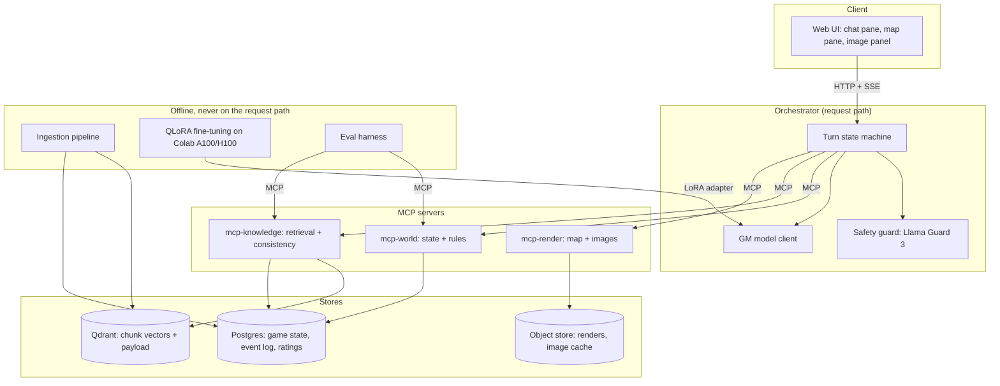
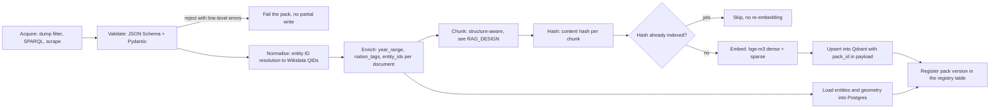
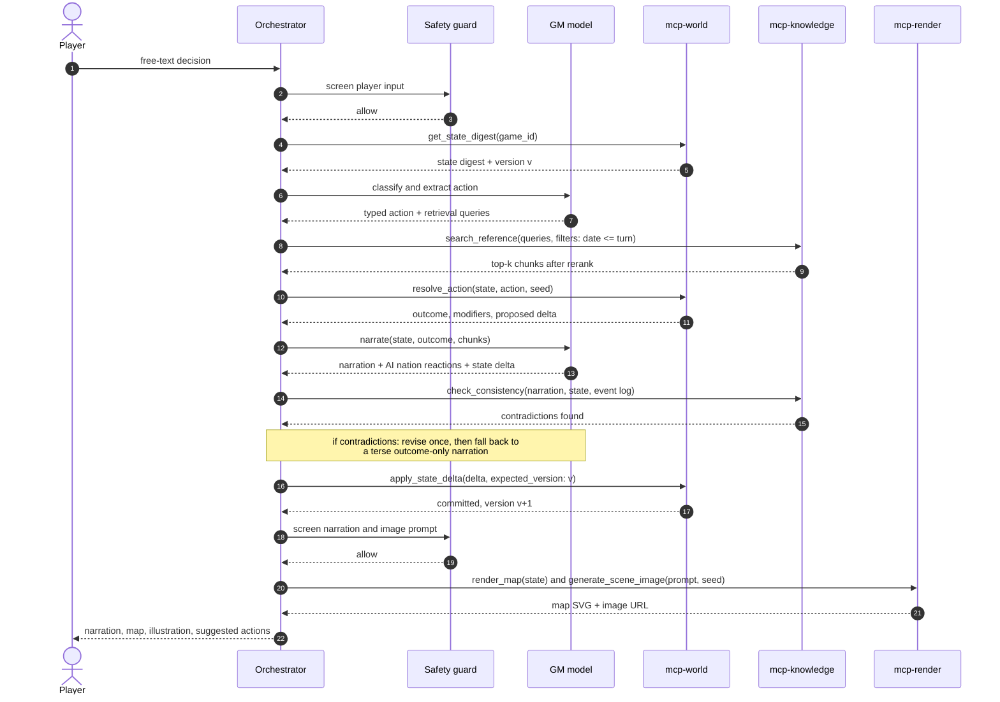
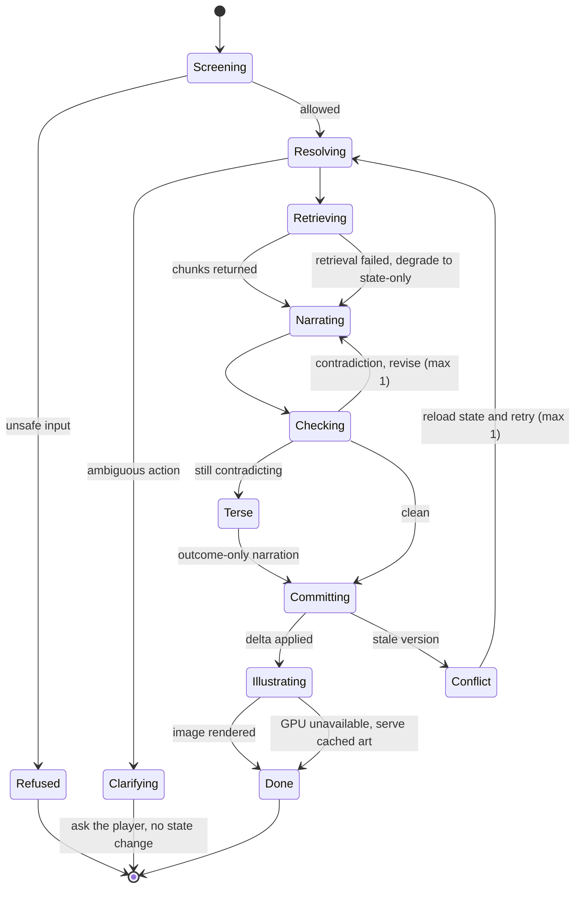

# Milestone 2 — Architecture

**Project:** WWII DIY — an AI-run alternate-history WWII game
**Authors:** Iclozan Mihnea-Serban, Rusu Mihai, Mogosan Sergiu-Ionut
**Date:** 2026-10-30 · **Status:** proposed for review
**Precedes:** [RFC-001](RFC.md) · **Companions:** [RAG_DESIGN.md](RAG_DESIGN.md),
[GOLDEN_DATASET.md](GOLDEN_DATASET.md), [PLAN.md](PLAN.md)

Every design subsection below is written as **Decision → Why → Rejected**, so the
trade-off behind each choice is visible without reading the surrounding prose.

---

## 1. The task the system handles

The player leads one of eight nations from September 1939 onward.
Each turn covers one month and consists of a single free-text decision.

In system terms, one turn is a **grounded, stateful, tool-using generation task**:

> Given an authoritative world state, an append-only event log, a free-text player
> action and a retrievable corpus of 1940s reference material, produce (a) a
> validated state delta, (b) a narration consistent with the state, (c) reactions
> for the seven non-player nations, and (d) an updated map and scene illustration.

This is deliberately narrower than "an LLM plays a game".
Four of those five outputs are checkable against something other than taste:

| Output | Checkable against |
|---|---|
| State delta | JSON Schema + rules engine legality + state version |
| Narration | the state and event log, via `check_consistency` |
| Nation reactions | the diplomatic-relations sub-state |
| Map | rendered from state geometry, so correct by construction |
| Scene image | CLIPScore against the narration |

### 1.1 The failure mode we are designing against

**Decision.** The language model never owns the truth about the world.
It reads state through tools and proposes changes; deterministic code decides
whether those changes happen.

**Why.** The RFC's whole motivation is that existing LLM sandbox games keep the
world in the prompt, so after a few dozen turns the model has forgotten which
territories the player holds and which armies were destroyed.
Any amount of context window only postpones that.
Moving the state out of the model and behind a transactional store removes the
failure class rather than reducing its probability.

**Rejected.** Long-context prompting with the full history replayed each turn —
cost grows quadratically in a 60-turn game, and it still gives the model write
access to its own ground truth.
Also rejected: summarising history into the prompt, which is lossy exactly where
precision matters (unit counts, treaty terms).

### 1.2 Non-goals

- Historical accuracy. The game starts from the real September 1939 situation and
  diverges from there. The constraint is **self-consistency**, not fidelity.
- Real-time play. One turn is a request/response cycle of a few seconds, not a
  simulation tick.
- Multiplayer. Single player, single nation, for the MVP.

---

## 2. Component and deployment view



Two boundaries in that picture carry most of the design weight.

The **offline / request-path split** means ingestion and fine-tuning can run on an
ephemeral Colab runtime without the game depending on one being alive.
Ingestion writes to Qdrant and Postgres and exits; the game only reads.

The **orchestrator / MCP split** means the eval harness drives the same tools the
game does, over the same protocol, with no game-specific test doubles.
A retrieval regression therefore shows up in the harness before it shows up in a
playthrough.

---

## 3. Data

### 3.1 Sources

| # | Source | Content | Licence | Est. size | Used for |
|---|---|---|---|---|---|
| D1 | Wikipedia WWII subset (`wikimedia/wikipedia` dump, category-filtered) | Narrative reference: campaigns, nations, leaders, units, equipment | CC BY-SA 4.0 | 25-40k articles | RAG corpus (bulk) |
| D2 | Wikidata (SPARQL) | Canonical entity attributes: nations, leaders, units, equipment specs, city coordinates, dates | CC0 | ~15k entities | Entity table, retrieval filters, map anchors |
| D3 | HyperWar (ibiblio), US Army CMH "Green Books", Project Gutenberg WWII texts | Operational detail and period voice | Public domain | ~400 documents | RAG corpus (depth + style) |
| D4 | Natural Earth 1:50m admin-0, plus hand-authored 1939 border GeoJSON | Base geometry and 1939 political boundaries | Public domain / CC0 | ~60 features | `render_map` |
| D5 | Equipment and order-of-battle tables, derived from D1 list-articles + D2 | Tanks, aircraft, ships, divisions with year-introduced and specs | CC BY-SA 4.0 | ~2.5k rows | Rules engine, anachronism checks |
| D6 | Our own playthrough transcripts, from the teacher model, team-filtered | GM behaviour: narration, tool calls, state deltas, image prompts | ours | 3-6k examples | QLoRA fine-tuning |

**Decision.** Wikipedia is the corpus backbone, Wikidata is the schema backbone.

**Why.** We need two different things and no single source gives both.
Narration needs flowing prose about campaigns and people, which is D1 and D3.
The rules engine and the retrieval filters need exact, typed facts — a leader's
death date, a tank's year of introduction — which is D2, where values are
machine-readable and already reconciled.
Deriving typed facts by parsing prose would put an extraction error between us
and every anachronism check.

**Rejected.** Scraping a fandom wiki for Hearts of Iron IV, which would be
better-matched to game mechanics but is unlicensed and tuned to that game's
balance rather than to the 1940s.
Also rejected: a commercial history dataset, on cost and redistribution grounds —
the repo is public, so every source has to be one we can legally commit or script.

### 3.2 Licence handling

CC BY-SA 4.0 on D1/D5 is share-alike, so it constrains what we commit.
We commit **acquisition scripts and chunk manifests**, not redistributed article
text, and `source_license` plus `source_url` travel in every chunk's payload so
any retrieved passage can be attributed in the UI.
That keeps the repository clean of share-alike text while keeping the corpus
exactly reproducible from a dump id.

---

## 4. Data ingestion: the data-pack format

The RFC commits to a world defined by data rather than code.
The concrete mechanism is a **versioned data pack**.

### 4.1 Pack layout

```
packs/base-1939/
  pack.yaml            # id, version, start_date, licence, source manifest
  entities/
    nations.json       # schema-validated structured state
    leaders.json
    regions.json
    armies.json
    technology.json
    relations.json
  corpus/
    wikipedia.jsonl    # {doc_id, title, text, url, license, year_range, tags}
    hyperwar.jsonl
  geo/
    borders_1939.geojson
```

A pack is the unit of content, versioning and removal.
`packs/whatif-1942/` with a different `start_date` and a few overridden entity
files is a complete new scenario with no code change, which is precisely the
"supports ingesting new data" requirement.

### 4.2 Pipeline



### 4.3 Properties we need from it

**Decision.** Ingestion is an idempotent, content-addressed, incremental offline
job, invoked as `python -m ingest packs/base-1939`.

**Why.** Four properties follow from that one sentence, and we need all four.
*Idempotent*, because Colab runtimes die mid-run and the retry must be safe.
*Content-addressed*, because re-embedding 40k articles after a one-article fix
wastes a GPU session — only changed chunks are re-embedded.
*Incremental*, because the corpus grows through the project and a full rebuild
would become the slowest step in every experiment.
*Offline*, because embedding throughput must never contend with turn latency.

**Rejected.** Embedding on first access ("lazy RAG"), which makes the first turn
that touches a new topic unpredictably slow and makes retrieval metrics depend on
cache warmth.
Also rejected: a single monolithic index with no `pack_id`, which would make a
fictional what-if pack permanently contaminate the base scenario; the payload
field lets us filter or drop a pack in one operation.

**Validation is fail-closed.** A pack that does not satisfy the schema is rejected
whole, with line-level errors, and nothing is written.
A half-loaded pack is indistinguishable at runtime from a buggy rules engine,
and we do not want to spend a week finding that out.

---

## 5. What the agent decides

This table is the architectural centre of the project.
It is also the dividing line the golden set **G2** tests directly.

| # | Decision | Owner | Why there |
|---|---|---|---|
| 1 | Is the action legal, in scope, and unambiguous? | **Agent** | Needs natural-language judgement; a clarifying question is a valid turn outcome |
| 2 | Classify intent and extract arguments: actor, target, intensity, resources | **Agent** | Free text to typed action is exactly what the fine-tune is for |
| 3 | What reference material to retrieve, and whether it was enough | **Agent** | Query formulation from an action is a generative step; sufficiency is a judgement |
| 4 | Which of the seven AI nations act this month, and what they do | **Agent** | Plausible statecraft under incomplete information |
| 5 | Has the scene changed enough to warrant a new illustration, and what is the prompt? | **Agent** | A visual-salience judgement; also a cost control |
| 6 | The prose: narration in second person, period voice | **Agent** | The core generative task |
| 7 | Accept its own narration, or revise after a consistency failure | **Agent** | Repair needs the text and the contradiction together |
| — | — | — | — |
| 8 | Outcome of a resolved action: dice, modifiers, probabilities | **Code** `resolve_action` | Must be seeded and replayable; an LLM cannot be a fair referee of itself |
| 9 | Whether a proposed state delta is valid and applied | **Code** `apply_state_delta` | The single writer; the trust boundary |
| 10 | Map geometry | **Code** `render_map` | Derived from state, so correct by construction |
| 11 | Victory, defeat, and the ending | **Code** `evaluate_victory` | Computed from accumulated state, which is what makes decisions matter |
| 12 | Safety verdict on input, output and image prompt | **Code** + classifier | Must not be reasoned around by the model it is guarding |

Rows 8-12 are the reason this is an *agent architecture* and not a prompt.
The model's authority stops at proposing; the proposal is adjudicated.

### 5.1 Turn control flow



The ordering of steps 17 and 19 is deliberate: the narration is generated
**before** the state is committed, and committed only with `expected_version`.
If the narration is unsalvageable, nothing was written.
If two turns race, the stale one is rejected rather than applied.

### 5.2 Degradation



Every non-core node has a degradation edge, and all of them terminate the turn.
Retrieval, consistency repair and illustration can each fail without the player
losing their move, because a game that drops a turn is worse than a game with a
plain description and last month's picture.

---

## 6. Tool inventory

| Tool | Server | Signature sketch | Writes? |
|---|---|---|---|
| `get_state` | world | `(game_id) -> WorldState` | no |
| `get_state_digest` | world | `(game_id, budget_tokens) -> StateDigest` | no |
| `get_event_log` | world | `(game_id, last_n) -> Event[]` | no |
| `resolve_action` | world | `(state, TypedAction, seed) -> Outcome + StateDelta` | **no — pure** |
| `apply_state_delta` | world | `(game_id, StateDelta, expected_version) -> version` | **yes — only writer** |
| `advance_turn` | world | `(game_id) -> TurnHeader` | yes |
| `evaluate_victory` | world | `(game_id) -> VictoryStatus` | no |
| `search_reference` | knowledge | `(queries, filters, k) -> Chunk[]` | no |
| `get_document` | knowledge | `(doc_id, span) -> Passage` | no |
| `resolve_entity` | knowledge | `(surface_form, type_hint) -> Entity + 1-hop neighbours` | no |
| `check_consistency` | knowledge | `(narration, state, event_log) -> Contradiction[]` | no |
| `render_map` | render | `(state, projection) -> SVG` | no |
| `generate_scene_image` | render | `(prompt, character_refs, seed) -> image_url` | cache only |
| `get_character_sheet` | render | `(character_id) -> description + seed + ref image` | no |

**Decision.** `resolve_action` is pure and `apply_state_delta` is the only writer.

**Why.** Splitting "what would happen" from "make it happen" buys three things at
once.
The model can be shown an outcome before anything is committed, so a bad
narration costs nothing.
`resolve_action` becomes a pure function of `(state, action, seed)`, which makes
the rules engine unit-testable and the whole game replayable — and replay is the
mechanism behind experiment **E8**, where we replay one start with different
decisions and measure divergence.
And having exactly one writer means the trust boundary is one function, not
thirteen.

**Rejected.** A combined `do_action` that resolves and commits, which is one fewer
round trip but gives up replay, pre-commit inspection, and the single-writer
guarantee.

---

## 7. MCP server design

### 7.1 Three servers, split by concern

**Decision.** Three MCP servers — `mcp-world`, `mcp-knowledge`, `mcp-render` —
rather than one.

**Why.** They have genuinely different operational shapes, and one process would
have to be built for the worst of all three.
`mcp-render` needs a GPU and takes seconds, so it must be independently scalable
and independently failable; a dead image model must not take state access down.
`mcp-world` is the trust boundary and the only thing holding a database
transaction, so it gets the strictest validation and the smallest dependency set.
`mcp-knowledge` is the only component that touches Qdrant, so the retrieval
experiments in [RAG_DESIGN.md](RAG_DESIGN.md) can swap encoder, index and
reranker behind a frozen tool signature, without the orchestrator noticing.

**Rejected.** A single server, simpler to launch but coupling GPU lifetime to
state availability and making the retrieval swap a redeploy of everything.
Also rejected: one server per tool, which multiplies process management for no
isolation we actually need.

### 7.2 Transports

- **stdio** for local development and for the eval harness, which spawns servers
  as subprocesses and needs no network setup.
- **Streamable HTTP** for the web app, where the orchestrator and `mcp-render`
  may sit on different machines — in particular when the GPU is a Colab runtime
  reached through a tunnel.

### 7.3 Which MCP primitives we use, and why each

| Primitive | Our use | Why this primitive |
|---|---|---|
| **Tools** | the 14 above | Model-invoked actions with typed arguments |
| **Resources** | `world://state/{game_id}`, `pack://{pack_id}/manifest`, `doc://{doc_id}` | Addressable read-only context the client can attach without spending a tool call |
| **Prompts** | `gm_turn`, `narrate`, `image_prompt` | Keeps prompt templates server-side and versioned with the tools they call, so a prompt change is reviewable and cannot drift from the schemas |
| **Progress notifications** | `generate_scene_image` | Image generation takes seconds; the UI streams progress instead of blocking |

Serving prompt templates as MCP prompts rather than hard-coding them in the
orchestrator matters more than it looks: the turn prompt and the tool schemas
have to agree exactly, and keeping them in the same server means they are changed
and reviewed together.

### 7.4 Contract discipline

- Every tool has a JSON Schema for input **and** output, generated from the same
  Pydantic models the rules engine uses. One definition, no drift.
- Optimistic concurrency on `apply_state_delta` via `expected_version`.
  A delta computed against a stale state is rejected, not merged.
- Deterministic seeding: the RNG seed is an explicit argument, never ambient.
  Same state plus same action plus same seed gives the same outcome, always.
- Full call logging: every tool invocation records inputs, outputs, latency and
  model version into Postgres, which is what makes a whole game replayable and
  what the eval harness reads.
- No ambient authority: `game_id` scopes every call, and no tool takes a
  filesystem path or a credential as an argument.

### 7.5 Why MCP at all

The honest alternative is plain function-calling against local Python functions,
which is less work.
We choose MCP for one concrete reason: the **eval harness, the web app and a
generic MCP client such as Claude Desktop all drive the identical tool surface**.
That means the retrieval and tool-call experiments in [PLAN.md](PLAN.md) run
against the shipped tools rather than against a test-only reimplementation of
them, which is the usual way an evaluation stops predicting production.
The process separation it forces also gives us the GPU isolation in §7.1 for
free.

---

## 8. Model choices

Colab A100 (40GB) and H100 (80GB) is the compute budget, which puts an 8B QLoRA
fine-tune comfortably in reach and makes 4-step diffusion per turn affordable.
What it does *not* give is persistence, and §9 deals with that.

### 8.1 GM model (the fine-tuned SLM)

| Candidate | Params | Licence | For | Against |
|---|---|---|---|---|
| **Qwen3-8B** | 8B | Apache-2.0 | Strongest open 8B at tool-calling and schema-constrained JSON; 32k native context; permissive licence | Narration style needs more steering than Llama |
| Llama-3.1-8B-Instruct | 8B | Llama Community | Largest tooling ecosystem; strong prose | Custom licence with naming and acceptable-use terms; weaker strict-JSON adherence |
| Gemma-3-4B-it | 4B | Gemma Terms | Half the latency; fits a smaller fallback GPU | Noticeably weaker at multi-tool sequences |

**Decision.** **Qwen3-8B** as the primary, QLoRA-fine-tuned; **Gemma-3-4B-it** kept
as a low-latency fallback. Confirmed by a bake-off in **E3** against G2 and G4.

**Why.** Our highest-risk capability is not prose quality — it is emitting a
correct tool sequence and a schema-valid state delta on every single turn, because
one malformed delta stalls a turn.
Qwen3 is the best open model in the 8B class at exactly that, and Apache-2.0
removes all licence friction from a public student repo.
Prose is the capability we can most reliably improve by fine-tuning on our own
transcripts; strict structural compliance is the one we would rather start from.

**Rejected.** A frontier API model, which would beat anything we fine-tune but
contradicts the RFC's premise of a cheap, local, privacy-preserving GM and makes
per-run cost a project risk.
Also rejected: a 14B+ open model — it fits an H100 for training, but not the
quantized local demo path in §9, and we do not want the demo to depend on a
live cloud runtime.

**Fine-tuning setup.** QLoRA, 4-bit NF4 with double quantization, LoRA rank 32,
alpha 64, dropout 0.05, targeting all attention and MLP projections; `peft` +
`trl` `SFTTrainer`; lr 1e-4 cosine with warmup; gradient checkpointing;
effective batch 16 via accumulation.
On H100 we train LoRA in bf16 without the 4-bit base where it fits, since quality
is better and the session length allows it.
Preference tuning (DPO) on the thumbs-up/thumbs-down data follows in W12, only if
SFT has landed — it is explicitly on the cut list in [PLAN.md](PLAN.md).

### 8.2 Teacher model for synthetic transcripts

**Decision.** **Qwen3-32B** (or Llama-3.3-70B-Instruct when an H100 is available),
run by us, generating playthrough transcripts that the three of us then filter and
correct.

**Why.** Distilling from a same-family larger model keeps the tool-call format and
JSON style close to what the student model already does well, which raises the
yield of the filtering pass.
Running it ourselves makes generation reproducible and free at the margin, and
avoids depending on an external provider's terms for training data.

**Rejected.** Generating transcripts with a frontier API model — higher quality
per sample, but adds cost per regeneration and a terms-of-service question about
training on the outputs, in a repo we intend to keep public.

### 8.3 Supporting models

| Role | Choice | Licence | Rationale |
|---|---|---|---|
| Embeddings | `BAAI/bge-m3` | MIT | Dense + sparse + multi-vector from one model, 8192 ctx, multilingual. Full rationale and the comparison set are in [RAG_DESIGN.md](RAG_DESIGN.md) §3 |
| Reranker | `BAAI/bge-reranker-v2-m3` | Apache-2.0 | Same family as the encoder; large precision gain at top-5 for one extra GPU pass |
| LLM judge | Llama-3.3-70B-Instruct | Llama Community | **Different family from the GM**, to limit self-preference bias; calibrated against human scores on 20 items (**E6**) |
| Safety | `Llama-Guard-3-8B`, with `ShieldGemma-2B` as the latency fallback | Llama Community / Gemma | Screens player input, GM output and image prompts. Over-refusal is measured on G5, not assumed away |
| Image | `FLUX.1-schnell` | Apache-2.0 | 4-step generation, strong prompt adherence, and a licence we can actually ship |
| Image fallback | `SDXL-Turbo` | Stability non-commercial research | 1-step and faster, but the licence is why it is the fallback and not the default |

**Image consistency.** A locked style LoRA gives the 1940s illustration look; each
recurring character has a fixed seed plus a reference image used through an
IP-Adapter, so the same leader renders recognisably across a 60-turn game.
Per the RFC: no graphic violence, and no photorealistic depictions of real people.

### 8.4 Why a judge at all, and its limits

An LLM judge is the only way we can score narrative quality on every run instead
of three times a semester.
It is also the least trustworthy number in the evaluation, so **E6** calibrates it
against all three of us on a 20-item subset and reports Spearman ρ.
If ρ < 0.6 we report human scores on a small sample and label the judge
unreliable rather than quoting it.
Stating that threshold now is the point: it stops us from arguing about the number
after we have seen it.

---

## 9. Working within the Colab constraint

Colab gives us A100/H100 class GPUs and no persistence.
Sessions expire at 12-24 hours, runtimes are reclaimed without warning, and there
is no stable URL.
Three mitigations are architectural, not operational, so they belong here.

**Checkpoint outward, always.** LoRA adapters are pushed to the Hugging Face Hub
at the end of every epoch, never only to the session disk.
A reclaimed runtime then costs at most one epoch.

**A demo path that does not need Colab.** For the Week 14 presentation the chosen
adapter is merged and quantized to a 4-bit GGUF and served through Ollama on a
laptop, with the image cache pre-warmed.
The live-Colab path through a tunnel stays as the nicer option, but the
presentation does not depend on it.
This is why §8.1 rules out a 14B model: the demo path has to fit a laptop.

**Cache the expensive, slow thing.** Scene images are keyed by prompt plus seed
plus character refs and cached in object storage.
A dead GPU degrades a turn to previously rendered art instead of breaking the
turn loop, which is the degradation edge in §5.2.

---

## 10. Decisions still open

Each has a date by which we will have decided, and the experiment that decides it.

| Open question | Decided by | How |
|---|---|---|
| Which state variables the rules engine tracks, and at what granularity | W6 (6 Nov) | Rules spec v0.1; granularity set by what the map and victory conditions actually need |
| Qwen3-8B vs Gemma-3-4B as the shipped GM | W8 (20 Nov) | **E3** bake-off on G2 and G4 |
| Whether entity-anchored retrieval (R6) earns its complexity | W10 (4 Dec) | **E2b**; shipped only if multi-hop Recall@10 gains ≥ 5 points |
| Acceptable per-turn latency with illustration included | W11 (11 Dec) | **E7** latency budget; target p50 < 8s, p95 < 15s |
| Whether DPO on player ratings happens at all | W12 (18 Dec) | Only if SFT has landed and ≥ 300 rated turns exist |
| Fine-tuning set size: 3k or 6k transcripts | W9 (27 Nov) | **E4** data-scaling curve at 1k / 3k / 6k |

---

## 11. Requirement coverage

| Milestone 2 requirement | Where |
|---|---|
| Problem and data — task | §1 |
| Problem and data — dataset | §3 |
| Problem and data — ingesting new data | §4 |
| Golden dataset | [GOLDEN_DATASET.md](GOLDEN_DATASET.md) |
| RAG design | [RAG_DESIGN.md](RAG_DESIGN.md) |
| Agent and tools — decisions | §5 |
| Agent and tools — tools | §6 |
| Agent and tools — MCP server | §7 |
| Model choices | §8 |
| Plan and experiments | [PLAN.md](PLAN.md) |
