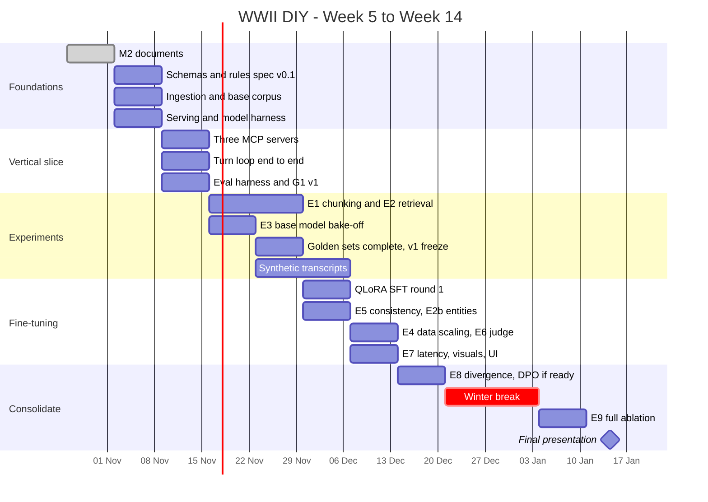

# Milestone 2 — Plan and Experiments

**Companions:** [ARCHITECTURE.md](ARCHITECTURE.md), [RAG_DESIGN.md](RAG_DESIGN.md),
[GOLDEN_DATASET.md](GOLDEN_DATASET.md) · **Precedes:** [RFC-001](RFC.md)

---

## 1. Calendar anchor

Everything below is numbered by course week, so if this anchor is off by a week,
only this table needs changing.

| | |
|---|---|
| Today | Friday 30 October 2026 |
| Assumed current week | **Week 5** (week of Mon 26 Oct 2026) |
| Winter break | Mon 21 Dec 2026 – Sun 3 Jan 2027, no work planned |
| Final presentation | **Week 14**, week of Mon 11 Jan 2027 |
| Working weeks remaining | 9 (W6–W14) |

> **Reviewer note:** the week numbering is the one assumption in this document we
> could not verify. If Week 14 falls elsewhere, the sequence and dependencies hold
> and only the dates shift.

### 1.1 Who owns what

Three workstreams, split by system boundary so each owns an interface rather than
a task type.

| | Workstream | Owner | Scope |
|---|---|---|---|
| **A** | World, Rules & MCP | Iclozan Mihnea-Serban | State schema, rules engine, `mcp-world`, orchestrator contracts, G2 |
| **B** | Data, RAG & Evaluation | Rusu Mihai | Ingestion, corpus, chunking, embeddings, Qdrant, `mcp-knowledge`, eval harness, G1 + G3 |
| **C** | Models, Fine-tuning & Visuals | Mogosan Sergiu-Ionut | Base-model bake-off, QLoRA, serving, safety, `mcp-render`, G4 + G5 |

The orchestrator and the web UI are shared: A owns the contracts it calls, B owns
its retrieval node, C owns the model it prompts.

---

## 2. Timeline

---

## 3. Week by week

### Week 5 — 26 Oct to 1 Nov · *current*

**Focus.** Milestone 2 documents.

- [x] RFC-001 uploaded
- [ ] This document set pushed to `docs/` on branch `docs/milestone-2`
- [ ] Repository scaffold: `packs/`, `eval/`, `src/`, `Makefile`, CI skeleton

**Done when** the four documents are on GitHub and the instructor can leave
inline comments on them.

---

### Week 6 — 2 Nov to 8 Nov

**Focus.** Freeze the three interfaces, so W7 can genuinely run in parallel.

| Owner | Deliverable |
|---|---|
| A | `WorldState` + `StateDelta` Pydantic models and JSON Schema; rules spec v0.1 naming every tracked variable; `resolve_action` for the attack and fortify classes |
| B | Ingestion pipeline running end to end; D1 filtered subset and D2 SPARQL pull; ~8k chunks indexed in **Chroma** under C1 chunking |
| C | vLLM serving Qwen3-8B on Colab; tool-calling smoke test; Llama Guard wired as a callable |
| All | 60 G1 items and 40 G2 items drafted |

**The three interfaces frozen this week:** the state schema, the
`search_reference` signature including its filter fields, and the turn-prompt
block order and token budget.

**Done when** three stub MCP servers answer their tool calls with schema-valid
mock data, and `make ingest packs/base-1939` runs clean twice in a row — the
second run writing nothing, which is the idempotency property from
[ARCHITECTURE.md](ARCHITECTURE.md) §4.3.

**Resolves** the first open question in ARCHITECTURE §10: which state variables
we track.

---

### Week 7 — 9 Nov to 15 Nov

**Focus.** One playable turn, end to end, however rough.

| Owner | Deliverable |
|---|---|
| A | `mcp-world` real implementation: `get_state`, `get_state_digest`, `resolve_action`, `apply_state_delta` with `expected_version`, `advance_turn`, event log |
| B | `mcp-knowledge`: `search_reference` with dense retrieval and the `year_range` filter; `get_document` |
| C | `mcp-render`: `render_map` from state geometry; FLUX.1-schnell behind `generate_scene_image` |
| All | The turn state machine from ARCHITECTURE §5.1, paired on |

**Done when** a player types "fortify the Maginot Line" in a terminal client and
gets back a narration, a committed state delta, a rendered map and an
illustration — with the base, un-fine-tuned model.

This is the project's riskiest week. Everything after it is improvement of a
working system; before it, we have components. It is deliberately placed early
for that reason.

---

### Week 8 — 16 Nov to 22 Nov

**Focus.** Measurement replaces opinion.

| Owner | Deliverable |
|---|---|
| B | Migrate Chroma → **Qdrant** with named vectors; `make eval` harness; **E1** and **E2** running |
| A | Remaining action classes in the rules engine; `evaluate_victory`; G2 at 120 items |
| C | **E3** base-model bake-off; teacher-model transcript generation pipeline |
| All | G1 to 120 items, G3 and G4 started from W7 traces |

**Done when** `make eval` prints a table and `eval/reports/E1-chunking.md` and
`E3-basemodel.md` are committed.

**Resolves** ARCHITECTURE §10: Qwen3-8B versus Gemma-3-4B as the shipped GM.

---

### Week 9 — 23 Nov to 29 Nov

**Focus.** Freeze the golden sets; start the fine-tuning data.

| Owner | Deliverable |
|---|---|
| All | G1 → 180 items with the hand-written adversarial additions; G5 written; inter-annotator κ reported; **`golden-v1` tagged** |
| B | **E2** complete across R0–R6 and 4 encoders; shipped retrieval configuration decided |
| C | 3k filtered synthetic transcripts; leakage check against golden-v1 passing |
| A | Web UI skeleton: chat, map and image panes against the real turn loop |

**Done when** `golden-v1` is tagged, `eval/reports/E2-retrieval.md` is committed
and names the winning configuration, and the leakage check is green in CI.

**Resolves** ARCHITECTURE §10: the fine-tuning set size, via **E4**'s first points.

---

### Week 10 — 30 Nov to 6 Dec

**Focus.** First fine-tune; consistency checking.

| Owner | Deliverable |
|---|---|
| C | QLoRA SFT round 1 on 3k transcripts, A100/H100; adapter pushed to the HF Hub; evaluated on G2 and G4 against the base model |
| B | `check_consistency` implemented; **E5**; **E2b** on entity-anchored retrieval |
| A | Revision loop in the orchestrator, bounded at one retry; degradation edges from ARCHITECTURE §5.2 |

**Done when** the fine-tuned model beats the base model on G2 state-delta F1, and
E5 reports contradiction F1 with a false-positive rate on the clean slice.

**Resolves** ARCHITECTURE §10: whether R6 clears its 5-point multi-hop bar.

---

### Week 11 — 7 Dec to 13 Dec

**Focus.** Quality and cost.

| Owner | Deliverable |
|---|---|
| C | **E4** data-scaling curve at 1k/3k/6k; **E6** judge calibration against all three of us; character-consistency pass with the style LoRA and per-character seeds |
| A | **E7** per-stage latency budget; prompt caching on the static prefix; p50 target < 8s |
| B | Anachronism-rate instrumentation live in the running game, not only in eval |
| All | Player-rating UI, the 👍/👎 that feeds DPO |

**Done when** p50 turn latency is under 8s with illustration, and E6 reports
Spearman ρ between judge and human scores.

**Resolves** ARCHITECTURE §10: acceptable per-turn latency, and whether R5 runs
always or per-turn.

---

### Week 12 — 14 Dec to 20 Dec

**Focus.** Does any of it make decisions matter?

| Owner | Deliverable |
|---|---|
| A | **E8** divergence study: replay one September 1939 start with 5 decision paths × 3 seeds, measure final-state distance |
| C | SFT round 2 on 6k transcripts if E4 says the curve has not flattened; DPO **only if** SFT has landed and ≥ 300 rated turns exist |
| B | Long-game stability: three 40-turn playthroughs, consistency measured per turn |
| All | Scope-cut decision against §6, explicitly and in writing |

**Done when** E8 shows final-state distance that is significantly larger across
decision paths than across seeds. That result is the project's central claim; if
it fails, we have a storytelling engine, not a game, and we need Week 13 to say so
honestly.

**Resolves** ARCHITECTURE §10: whether DPO happens at all.

---

### Winter break — 21 Dec to 3 Jan

No work planned. Marked as a break rather than quietly used as slack, because a
plan that depends on the break is a plan that has already slipped.

---

### Week 13 — 4 Jan to 10 Jan 2027

**Focus.** The ablation that answers the RFC.

| Owner | Deliverable |
|---|---|
| All | **E9** full ablation: full system vs no-RAG vs no-consistency-check vs base-model-GM, across all five golden sets |
| C | The demo path: merge the chosen adapter, quantize to 4-bit GGUF, serve through Ollama locally, pre-warm the image cache |
| B | `golden-v2` tagged with any items added since W9 |
| A | Freeze `main`. Bugs only after Wednesday |

**Done when** `eval/reports/E9-ablation.md` is committed and the demo runs
end to end on a laptop with no Colab runtime attached.

---

### Week 14 — 11 Jan to 17 Jan 2027 · **final presentation**

| Owner | Deliverable |
|---|---|
| All | Slides built from the committed reports, not from remembered numbers |
| All | Live demo: a 6-turn playthrough as Romania, 1940, showing a divergence from real history |
| All | Final `docs/RESULTS.md` with every experiment's table |
| All | `docs/RETROSPECTIVE.md` — what we cut, and what we would do differently |

**Done when** the presentation is given and the repository reproduces the
headline numbers from a clean clone.

---

## 4. Experiments

Every experiment has an owner, a golden set, a metric, a threshold, and — the
column that justifies its existence — a decision it unblocks. An experiment that
changes nothing downstream is not scheduled.

| ID | Experiment | Week | Owner | Golden set | Primary metric | Decision it unblocks |
|---|---|---|---|---|---|---|
| **E1** | Chunking: C0 fixed vs C1 structure-aware vs C2 semantic | W8 | B | G1 | Recall@10, nDCG@10 | The shipped chunking strategy |
| **E2** | Retrieval: R0–R6 × 4 encoders incl. BM25 baseline | W8–W9 | B | G1 | Recall@10, RAGAS faithfulness, anachronism rate | The shipped retrieval configuration |
| **E2b** | Entity-anchored retrieval (R6) on the multi-hop slice | W10 | B | G1 multi-hop | Recall@10 delta; ships only if ≥ +5 pts | Whether R6 ships at all |
| **E3** | Base model: Qwen3-8B vs Llama-3.1-8B vs Gemma-3-4B | W8 | C | G2, G4 | Tool-selection acc., JSON validity, rubric mean | Which SLM we fine-tune |
| **E4** | Fine-tuning data scaling at 1k / 3k / 6k transcripts | W11 | C | G2, G4 | State-delta F1, rubric mean | Whether SFT round 2 is worth a GPU session |
| **E5** | Consistency checker quality | W10 | B | G3 | F1, false-positive rate on clean turns | Whether the revise loop runs, and its threshold |
| **E6** | LLM judge vs human agreement | W11 | C + all | G4 calibration subset | Spearman ρ; reliable iff ρ ≥ 0.6 | Whether we may quote judge scores at all |
| **E7** | Latency budget per pipeline stage | W11 | A | — | p50 / p95 per stage | Whether R5 is always-on or per-turn |
| **E8** | Action impact: 5 decision paths × 3 seeds from one start | W12 | A | — | Final-state distance across paths vs across seeds | **The project's central claim** |
| **E9** | Full ablation: full vs no-RAG vs no-consistency vs base GM | W13 | All | G1–G5 | All of the above | What we report in Week 14 |

### 4.1 E8 in more detail

E8 is the experiment the RFC's first differentiator rests on — "decisions always
have consequences" — so it needs to be specified before we run it, not after.

Five decision paths from the September 1939 Romania start, each played 20 turns,
each with three RNG seeds, giving 15 playthroughs.
Final-state distance is a weighted vector distance over territory control, army
strength by nation, diplomatic relations and technology level.

The claim holds if **between-path distance significantly exceeds within-path
(seed-only) distance**, by a Mann-Whitney U test at α = 0.05.
Fixing the test now is what stops us from choosing the statistic that flatters the
result.

If it fails, two causes are distinguishable and we say which: the rules engine's
modifiers are too weak for decisions to compound, or the narration dominates the
state and we are measuring a storyteller. Both are reportable findings.

---

## 5. Risks

| Risk | Likelihood | Impact | Mitigation |
|---|---|---|---|
| Colab runtime reclaimed mid-fine-tune | **high** | medium | Adapters pushed to the HF Hub every epoch; a lost session costs one epoch, not a week |
| No stable GPU for the Week 14 demo | **high** | high | The demo path is a merged 4-bit GGUF on a laptop with a warm image cache, built in W13 and never dependent on Colab |
| Synthetic transcripts too low-quality to fine-tune on | medium | high | Automatic filters plus a human pass; E4's 1k point tells us by W11 whether the curve is rising at all; fall back to prompt engineering on the base model, which W7 proves works |
| Turn latency unacceptable with illustration | medium | medium | E7 in W11; the image step is already async with a cache, and R5 is per-turn rather than always-on |
| Rules engine too shallow for E8 to show divergence | medium | **high** | Rules spec v0.1 in W6 is written with E8's distance metric in mind; W12 leaves a week to deepen modifiers if E8 is negative |
| Golden-set build slips and experiments have nothing to run against | medium | high | G1 built in two passes; the first 120 items land in W8, which is all E1 and E2 need |
| Three people, nine weeks, Christmas | — | — | §6 |

---

## 6. Scope cut list

In priority order, what we drop if we are behind. Deciding this in Week 5 rather
than Week 13 is the point: a plan without a cut list gets missed silently.

1. **DPO on player ratings.** Already conditional in W12. SFT is the claim; DPO is
   a refinement.
2. **R6 entity-anchored retrieval.** Already gated on E2b's 5-point bar.
3. **Character consistency via IP-Adapter.** Fall back to fixed seeds plus a fixed
   textual description, which is most of the benefit for a fraction of the work.
4. **Playable nations: 8 → 3.** Germany, the UK and Romania. The architecture is
   unchanged; only pack content shrinks.
5. **Semantic chunking (C2).** Drop from E1 and report C0 versus C1 only.
6. **The 60-turn long game.** Report 40-turn stability instead.

What we will **not** cut, because the project stops being the project without it:
the single-writer state boundary, `resolve_action` purity, the time-aware
retrieval filter, E8, and the five golden sets.

---

## 7. Deliverables by Week 14

| | Artefact | Location |
|---|---|---|
| 1 | Playable game, 8 nations, chat + map + illustrations | `src/`, demo |
| 2 | Three MCP servers with schema-tested contracts | `src/mcp_world`, `src/mcp_knowledge`, `src/mcp_render` |
| 3 | Fine-tuned GM adapter | HF Hub, versioned |
| 4 | Ingestion pipeline + `base-1939` pack + one what-if pack | `packs/` |
| 5 | Five golden sets, `golden-v2` | `eval/golden/` |
| 6 | Ten experiment reports, E1–E9 + E2b | `eval/reports/` |
| 7 | Results summary and retrospective | `docs/RESULTS.md`, `docs/RETROSPECTIVE.md` |
| 8 | Final presentation | slides + live demo |
