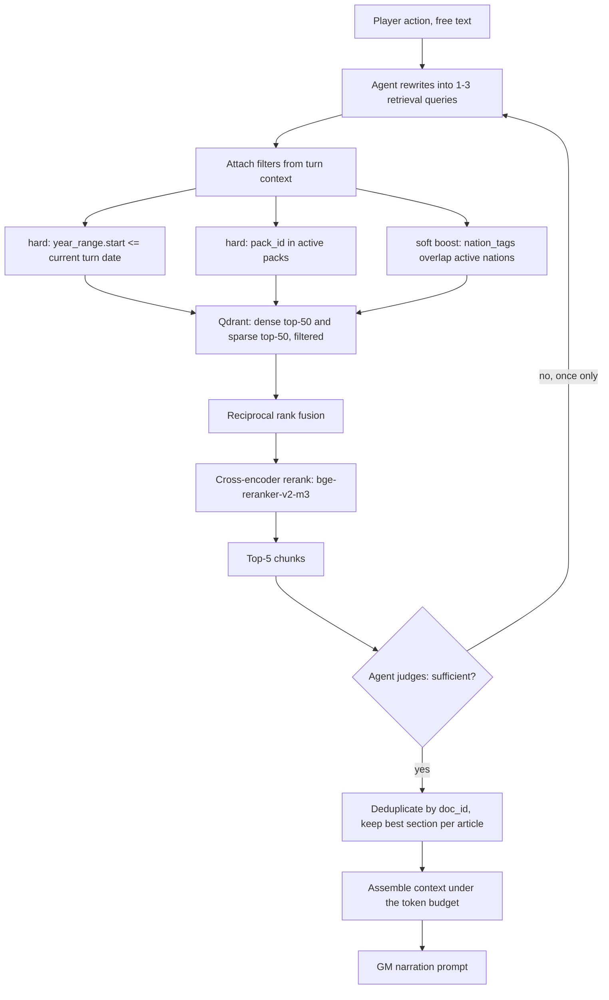

# Milestone 2 — RAG Design

**Companions:** [ARCHITECTURE.md](ARCHITECTURE.md), [GOLDEN_DATASET.md](GOLDEN_DATASET.md),
[PLAN.md](PLAN.md) · **Precedes:** [RFC-001](RFC.md)

Same convention as the architecture document: **Decision → Why → Rejected**.

---

## 1. What is retrieved, and what is not

**Decision.** The world state is never in the vector database.
Only *reference* knowledge about the 1940s is retrieved.

**Why.** These are two different kinds of knowledge and they need two different
guarantees.
"Which divisions does the player hold in Bessarabia this month" must be exact,
current and transactional — it is fetched verbatim via `get_state`.
"What did a Romanian armoured division of 1941 actually field" is approximate,
static background — that is retrieval.
Embedding the state would make the most precision-critical fact in the system
subject to nearest-neighbour recall, which is the single worst place to accept
approximate answers.

**Rejected.** Indexing state snapshots so the model can "search its own history".
The event log already answers that exactly, through `get_event_log`, and a
semantic search over past turns would reintroduce precisely the drift the RFC
exists to remove.

| | World state | Reference corpus |
|---|---|---|
| Store | Postgres | Qdrant |
| Access | `get_state`, `get_state_digest`, `get_event_log` | `search_reference`, `get_document` |
| Guarantee | exact, versioned, transactional | approximate, ranked |
| Mutability | every turn | only on ingestion |
| On a miss | an error — a bug | degrade to state-only narration |

---

## 2. Chunking

### 2.1 The strategies we compare

| ID | Strategy | Parameters |
|---|---|---|
| **C0** | Fixed-size recursive character split, our baseline | 512 tokens, 64 overlap |
| **C1** | Structure-aware: split on Wikipedia section headings, then recursive within an over-long section, with `article_title > section_path` prepended to each chunk | 256-768 adaptive, 64 overlap |
| **C2** | Semantic: breakpoints at embedding-similarity minima between consecutive sentences | 95th-percentile breakpoint threshold, 128-1024 bounds |

**Decision.** We ship **C1**. C0 and C2 are compared against it in **E1**.

**Why.** Our corpus is overwhelmingly Wikipedia and public-domain military
histories, both of which are already written in meaningful sections — "Background",
"Order of battle", "Aftermath".
Those headings are a free, exact segmentation that C2 has to rediscover
statistically and that C0 ignores entirely.
The prepended `article_title > section_path` header matters as much as the split
itself: a bare chunk reading "Losses were heavy on the second day" is almost
useless at retrieval time and actively misleading at generation time, whereas
"Battle of Crete > Aftermath — Losses were heavy..." is self-locating.

**Rejected.** C2 as the default, on cost and payoff.
It needs a full embedding pass just to decide boundaries, so every re-chunk costs
a second GPU pass over 40k articles, and the literature's gains over
structure-aware splitting on well-structured text are small.
We still measure it, because if it wins on D3 — the public-domain histories, which
have much weaker heading structure — we may apply it to that source only.
C0 stays as the baseline that every improvement has to beat; a design document
that cannot say what the floor is cannot claim a gain.

### 2.2 Chunk payload

Every chunk carries this payload, and the last three fields are the ones that make
retrieval work *for a game* rather than for a search box:

```json
{
  "chunk_id": "sha256:...",
  "doc_id": "wiki:Battle_of_Crete",
  "pack_id": "base-1939",
  "title": "Battle of Crete",
  "section_path": "Battle of Crete > Aftermath",
  "text": "...",
  "source_url": "https://en.wikipedia.org/wiki/Battle_of_Crete",
  "source_license": "CC-BY-SA-4.0",
  "year_range": [1941, 1941],
  "nation_tags": ["DEU", "GBR", "GRC", "NZL"],
  "entity_ids": ["Q153356", "Q183", "Q145"]
}
```

### 2.3 Why `year_range` is a first-class field

**Decision.** Every chunk gets a `year_range`, and `search_reference` applies a
**hard filter** of `year_range.start <= current_turn_date` by default.

**Why.** This is the retrieval failure mode specific to our project, and it does
not exist in ordinary document QA.
In November 1939 the most semantically relevant chunk for "should I invade
Norway" is the article about the actual April 1940 invasion — correctly retrieved
and catastrophically wrong, because it leaks the future into a game whose entire
premise is that the future is not written yet.
It would also quietly drag the narration back toward real history, which the RFC
explicitly rules out.
No amount of better embedding fixes this; it is a filtering problem, so we solve
it with a filter.

**Rejected.** Post-hoc filtering of a larger result set, which wastes the
candidate budget and silently returns fewer than `k` results exactly on the
turns where the future is most relevant.
A hard pre-filter in the index keeps `k` honest.
Also rejected: trusting the model to ignore anachronistic context, which asks the
component we least control to enforce the constraint we care most about.

`year_range` is derived during ingestion from Wikidata date properties where an
entity is linked, and from a date-extraction pass over the text otherwise.
Extraction quality is itself measured — it is a tagged slice of **G1**.

---

## 3. Embedding model

| Candidate | Dim | Ctx | Licence | For | Against |
|---|---|---|---|---|---|
| **`BAAI/bge-m3`** | 1024 | 8192 | MIT | Dense + sparse + ColBERT-style multi-vector from **one** model; multilingual, which matters for Romanian-language sources; 8k context fits whole sections | Heaviest of the three to run |
| `intfloat/multilingual-e5-large` | 1024 | 512 | MIT | Strong multilingual baseline, well understood | 512-token context truncates our larger C1 chunks; dense only |
| `nomic-embed-text-v1.5` | 768→64 | 8192 | Apache-2.0 | Matryoshka, so dimensions can be cut for cheap storage; fast | English-centric; dense only |
| *BM25* | — | — | — | *Lexical baseline, no GPU* | *No semantics* |

**Decision.** We ship **`bge-m3`**. All four are compared in **E2** on G1.

**Why.** Three reasons, in order of weight.
First, it produces dense **and** learned-sparse vectors from a single model and a
single pass, which means our hybrid retrieval (§6, R2) needs one encoder rather
than an encoder plus a separately-tuned BM25 index — a real reduction in moving
parts for a three-person team.
Second, 8192-token context means a long C1 section is embedded whole instead of
being split again for the encoder's benefit, so the chunk boundary stays the one
the document's author chose.
Third, it is genuinely multilingual, and D3 plus Romanian-language material about
the Romanian campaign would otherwise be badly served.

**Rejected.** `multilingual-e5-large`, on context length — 512 tokens would force
us back to C0-sized chunks and undo §2.
`nomic-embed-text-v1.5`, on multilinguality, despite Matryoshka being attractive
for storage; at our corpus size storage is not the binding constraint.
BM25 alone is not a candidate but *is* a required baseline: if dense retrieval
cannot beat BM25 on G1, the whole vector stack is unjustified, and we would
rather find that out in Week 8 than assume it.

---

## 4. Vector database

| Candidate | For | Against |
|---|---|---|
| **Qdrant** | Hard payload filters evaluated *inside* HNSW traversal, which is what §2.3 needs; named vectors, so several encoders coexist in one collection for E2; native sparse vectors for hybrid; scalar quantization; Docker, free, self-hosted | One more service to run |
| Chroma | Zero configuration, in-process, fastest possible start | Filtering is weaker and effectively post-hoc; no first-class sparse vectors; weaker story at 10⁵+ chunks |
| pgvector | One Postgres for state *and* vectors — one backup, one connection | Filter-plus-ANN planning is fragile; no built-in hybrid fusion or reranking; HNSW tuning is manual |

**Decision.** **Chroma for the Week 6-7 prototype, Qdrant for the final system.**
The migration is scheduled in W8 and is cheap because both sit behind
`search_reference`.

**Why.** Two of our hard requirements are database features, not application
features.
`year_range` filtering has to happen during graph traversal or it degrades into
over-fetch-then-discard, and Qdrant does that natively.
And **named vectors** let E2 hold three encoders' output in one collection and
switch by name, instead of maintaining three parallel deployments — which turns
the encoder comparison from a week of ops into a configuration flag.
We start on Chroma anyway because in W6 the bottleneck is having *any* corpus
indexed, and zero-config is worth more than the right index for two weeks.

**Rejected.** pgvector, which is architecturally the most appealing — one store
for everything — but we would have to hand-build hybrid fusion and filtered-ANN
tuning, and that is the week we would rather spend on the rules engine.
Chroma as the permanent choice, on filtering and sparse-vector support.
A hosted vector service: cost, plus corpus data leaving the project for no gain.

Index configuration: HNSW with `m=16`, `ef_construct=128`, `ef=64` at search time;
scalar quantization on the dense vectors; `pack_id`, `year_range` and `nation_tags`
declared as payload indexes so the filters are cheap.

---

## 5. Retrieval pipeline



The single-retry loop at the sufficiency check is bounded deliberately: an
unbounded agentic retrieval loop is the easiest way to turn a 4-second turn into
a 30-second one, and **E7** measures what the one retry costs us.

---

## 6. RAG approaches we compare

| ID | Approach | Hypothesis |
|---|---|---|
| **R0** | No retrieval, closed-book SLM | The floor. Establishes how much of the model's period knowledge is already parametric |
| **R1** | Naive dense top-k | The standard thing. If R1 ≈ R0, retrieval is not the bottleneck and we should spend the time elsewhere |
| **R2** | Hybrid dense + sparse with RRF fusion | Military text is dense with exact names — "Panzer IV Ausf. F2", "Operation Weserübung" — where lexical match beats semantics |
| **R3** | R2 + cross-encoder rerank | Precision at top-5 is what matters, because the context budget only fits 5 chunks |
| **R4** | **R3 + time-aware hard filter and nation boost** | Our shipped configuration. Removes the anachronism failure in §2.3, which no other variant addresses |
| **R5** | R4 + agentic query rewriting with one sufficiency retry | Free-text actions are not search queries; rewriting should lift recall on oblique actions |
| **R6** | R5 + entity-anchored retrieval: resolve entities to Wikidata QIDs, inject the 1-hop neighbourhood as a structured block beside the text chunks | Should carry the multi-hop slice of G1, e.g. "what did Romania's ally field in 1941" |

**Decision.** **R4 is what the game ships.** R5 is enabled per-turn only when the
action's entity count or ambiguity crosses a threshold.
R6 is a stretch, and §10 of [ARCHITECTURE.md](ARCHITECTURE.md) states the bar it
must clear: a multi-hop Recall@10 gain of at least 5 points, decided in W10.

**Why R4 and not R5 everywhere.** The rewrite-and-retry adds a model call and a
second retrieval round to every turn, and §5's bound exists because turn latency
is a player-facing property with a budget (p50 < 8s, from **E7**).
Spending that budget on the ~20% of turns where the action is genuinely oblique
is a better trade than spending it on all of them.

**Why R6 is a stretch and not a plan.** It needs entity linking that works, and
entity linking is its own research problem.
We would rather ship R4 well than ship R6 badly, and the 5-point bar is there to
stop us falling in love with the more interesting architecture.

All seven run against the same G1 golden set, the same chunking (C1) and the same
encoder, so the comparison isolates the retrieval strategy. This is **E2**.

### 6.1 Metrics

| Layer | Metric | Target |
|---|---|---|
| Retrieval | Recall@10, MRR, nDCG@10 against `gold_doc_ids` | Recall@10 ≥ 0.85 overall |
| Retrieval | **Anachronism rate**: share of retrieved chunks with `year_range.start >` turn date | ≤ 0.01 under R4 |
| Generation | RAGAS faithfulness, answer relevance, context precision and recall | faithfulness ≥ 0.85 |
| Generation | Exact match / token F1 on the short-factual slice | F1 ≥ 0.70 |
| Generation | Correct refusal rate on the unanswerable slice | ≥ 0.80 |
| Cost | Latency p50/p95, chunks per turn, GPU seconds per turn | see **E7** |

Anachronism rate is our own metric and the one we would most want a reviewer to
push back on. It is the only number here that measures the project-specific
failure, and it is cheap to compute because `year_range` is already in the payload.

---

## 7. Context assembly and token budget

An 8,192-token window, allocated explicitly rather than by whatever happens to
fit. The slots below total 8,100, leaving ~92 tokens of slack for tokenizer
variance:

| Slot | Budget | Notes |
|---|---|---|
| System prompt + rules summary | 1,200 | Static, served as an MCP prompt, prompt-cacheable |
| World state digest | 1,500 | From `get_state_digest(budget_tokens=1500)` — the server does the truncation, by salience, not the client |
| Recent event log | 800 | Last 5 turns, compressed to one line each |
| Retrieved chunks | 2,500 | Top-5 after rerank, each with its `section_path` header |
| Player action + turn header | 300 | |
| Reserved for output | 1,800 | Narration, reactions, delta, image prompt |

**Decision.** Fixed slot budgets, in a fixed order, with the state digest placed
immediately before the player's action.

**Why.** Fixed slots mean a long retrieval result can never squeeze out the state,
which would be exactly the wrong thing to drop.
The ordering exploits recency: the two blocks the model must not contradict —
the state and the action — sit closest to the generation point.
And keeping the static prefix first and byte-identical makes it prompt-cacheable,
which is a straight latency win on every turn.

**Rejected.** Letting retrieval take whatever is left after the state, which is
the easier implementation but makes context composition depend on corpus
verbosity. We would rather truncate the thing we can re-fetch than the thing we
cannot.

`get_state_digest` doing the truncation server-side is a deliberate choice:
deciding what is salient in the state needs the rules engine's knowledge of what
matters, and that knowledge lives in `mcp-world`, not in the orchestrator.

---

## 8. `check_consistency`: retrieval pointed inward

`check_consistency` is in `mcp-knowledge` rather than `mcp-world` because it is
structurally a retrieval problem, not a rules problem.

Given a narration, it extracts claims and checks each against a source of truth:

| Claim type | Checked against | Example contradiction |
|---|---|---|
| Unit existence, strength, location | `WorldState.armies` | A division narrated into a province it never reached |
| Person alive, in office | `WorldState.leaders` + event log | A leader killed in 1941 giving a speech in 1943 |
| Territory control | `WorldState.regions` | Narrating a city as held that the log never shows captured |
| Treaty or war status | `WorldState.relations` | Allied action between nations at war |
| Technology availability | `technology.json` `year_introduced` | Jet aircraft in 1940 |
| Past decision ignored | event log | A referendum result the story contradicts |

The first five are deterministic lookups once claims are extracted; only the
extraction is model-driven, and the sixth is a retrieval over the event log.

**Decision.** Claim extraction by the GM model under a constrained JSON schema,
verification by code.

**Why.** It is the §5 agent-versus-code split applied once more: finding the claims
in prose needs language understanding, deciding whether a claim is false needs the
database.
Asking one model call to do both is how you get a consistency checker that agrees
with whatever it just wrote.

Measured on **G3**, which has deliberately injected contradictions: precision,
recall and F1 on contradiction detection, plus false-positive rate on clean turns.
The false-positive rate matters more than it looks — a checker that flags clean
narrations forces needless revisions and burns the latency budget, so we treat
over-flagging as a real cost and not a safe default.

---

## 9. Which experiment settles what

| Experiment | Question | Golden set | Decision it unblocks |
|---|---|---|---|
| **E1** | C0 vs C1 vs C2 | G1 | The shipped chunking strategy |
| **E2** | R0-R6, and the 4 encoders | G1 | The shipped retrieval configuration |
| **E2b** | Does R6 clear the 5-point multi-hop bar? | G1 multi-hop slice | Whether entity-anchored retrieval ships at all |
| **E5** | Consistency checker quality | G3 | Whether the revise loop runs at all, and its threshold |
| **E7** | Latency per stage | — | Whether R5 is per-turn or always on |

Full schedule, owners and thresholds are in [PLAN.md](PLAN.md) §4.
